# Data Skaters Facilitator's Guide

Quick notes for running the Data Skaters AI Performance Lab. Use the slide image and notes together as you present.

## Before students arrive

- Choose a school-based event key, such as `MS` for Miskooseepi School, and enter it on every device.
- Test the [Data Skaters site](https://datadunkers.ca/skaters), [photo booth](https://datadunkers.ca/skaters/photobooth), [traits form](https://datadunkers.ca/skaters/traits), [shots form](https://datadunkers.ca/skaters/shots), and [card creator](https://datadunkers.ca/skaters/card-creator/index.html?testing=true).
- Arrange groups of six or fewer. Label each net with its group number and mark distances at 2, 5, 7, and 10 feet.
- Prepare camera-enabled devices, nets or targets, sticks, soft pucks or balls, measuring tape, tape, and markers.
- If Rocket League is included, prepare the computers, controllers, accounts, and matches.
- Set up a screen or projector and have card-printing supplies ready.
- Confirm media consent if photos will be shared.

## Slide 1: Program introduction

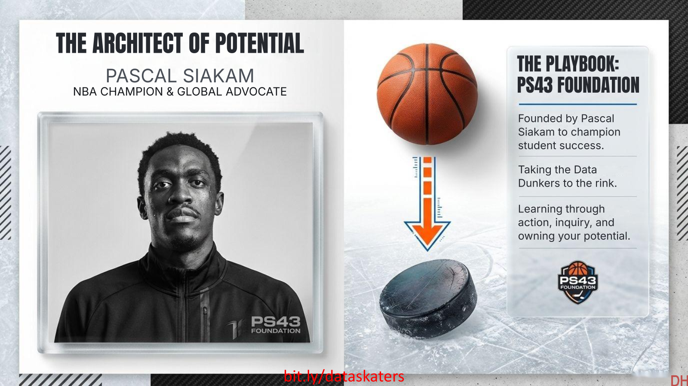

Introduce Data Skaters as a program inspired by Pascal Siakam. Keep this brief because the next slide covers the partners.

## Slide 2: Program supporters

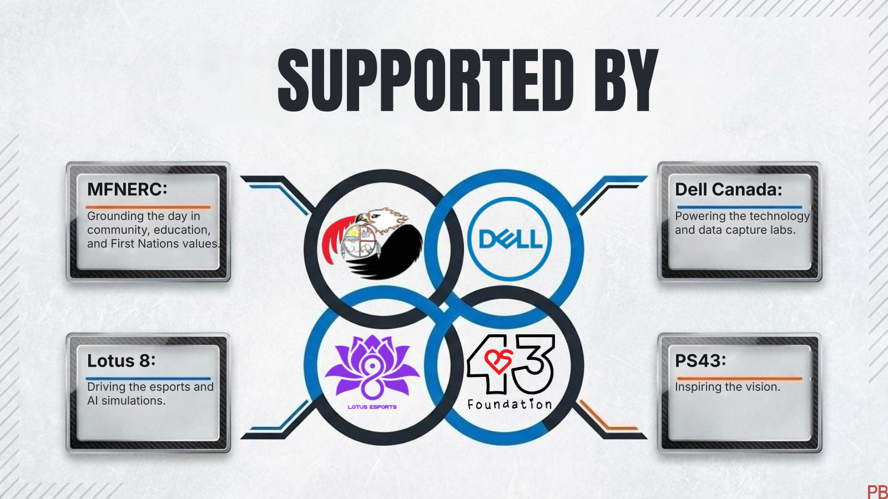

Introduce the PS43 Foundation, MFNERC, and Lotus 8 Esports. Karl can speak to MFNERC, and Steve can speak to Lotus 8.

Explain that PS refers to Pascal Siakam. The 4 represents Pascal's father and three brothers, while the 3 represents his mother and two sisters. This explanation is documented by Indiana University and Red Bull.

## Slide 4: The player card

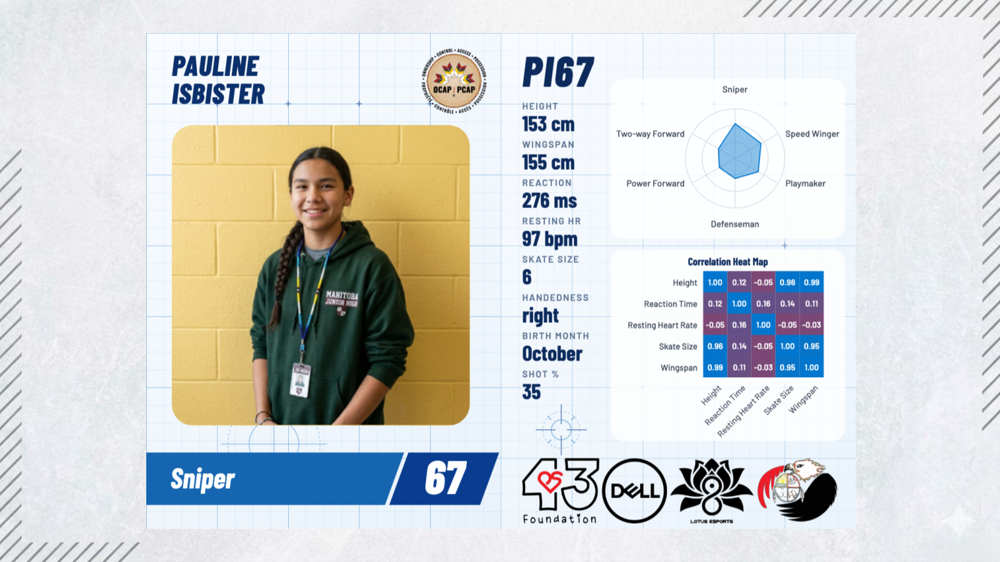

Show a completed card early. Tell students that the information they collect today will be used to create their own card, so accurate entries matter.

## Slide 5: The day's workflow

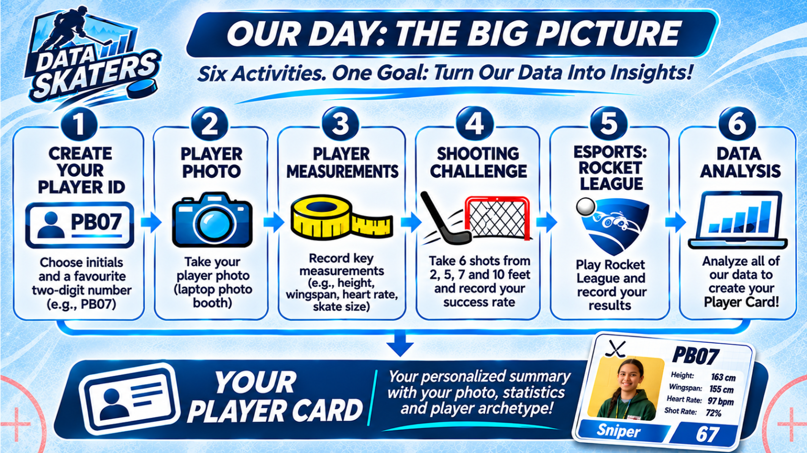

Use the numbers to preview the day:

1. Create a player ID using the student's actual initials and two digits, such as `PS43`. Students must use that exact ID all day. Although the forms call it a nickname, the initials must be the student's real initials so mistakes can be traced and corrected.
2. Take a photo for the card.
3. Record traits such as height, wingspan, heart rate, and reaction time.
4. Take six shots from each of 2, 5, 7, and 10 feet, and record the results.
5. Complete the optional Rocket League activity individually.
6. Analyze the data and create the cards.

## Slide 6: Team norms

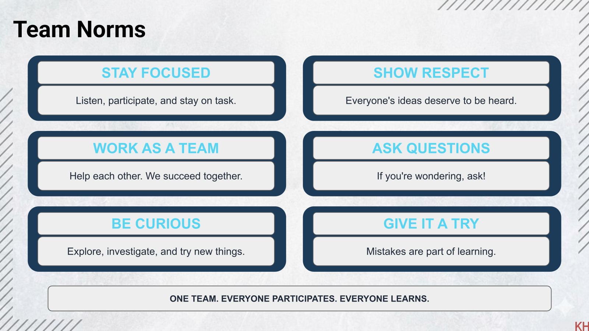

Review the six expectations: stay focused, show respect, work as a team, ask questions, be curious, and give it a try.

## Slide 8: Mindfulness and station roles

Steve leads the mindfulness activity. Use this time to brief adult helpers and assign one person to each station. Station facilitators keep students on task, support measurements and data entry, and flag missing information.

## Slide 9: Photo booth

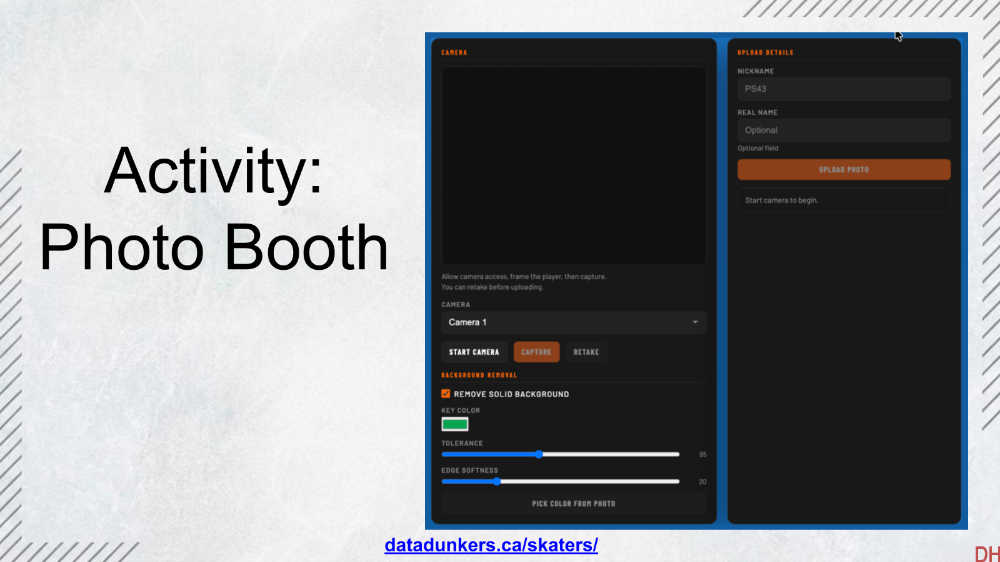

Open the [photo booth](https://datadunkers.ca/skaters/photobooth). Check the group name and player ID before taking the photo. The ID must use the student's actual initials and remain unchanged throughout the session. The full name field is optional.

Students select **Start Camera**, frame themselves, choose **Capture**, and retake the photo if needed. Leave **Remove Solid Backgrounds** unchecked unless a green screen is being used.

## Slide 10: Traits and measurements

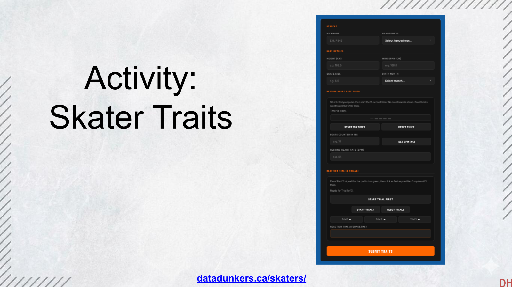

Provide measuring tape and marked wall space where possible. For wingspan, students measure from the centre of the body to one fingertip and double the result. Have students do the calculation themselves. Demonstrate and reset the timer before they begin.

## Slides 11-13: Data sovereignty

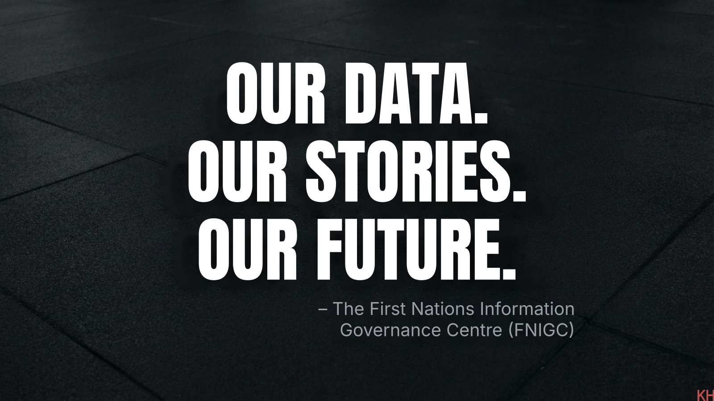

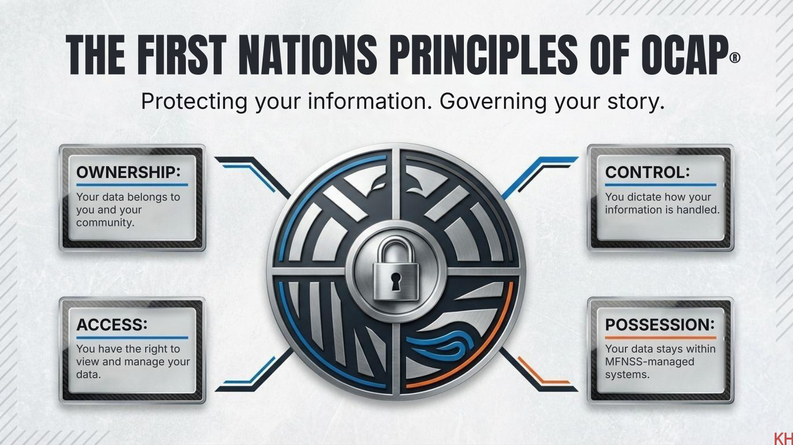

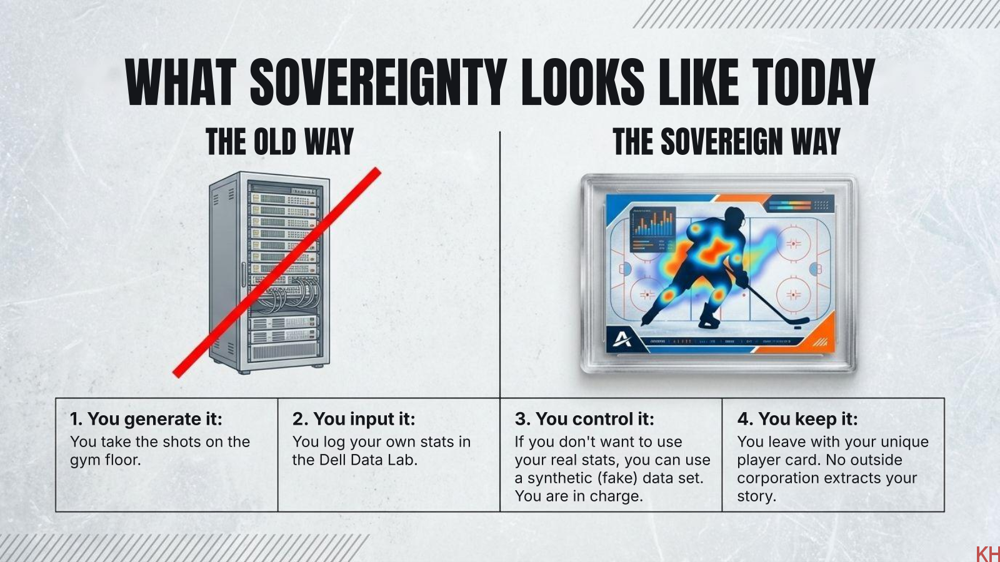

Connect the slides to the students' own information. Ask:

- Who owns the data?
- Who controls how it is used?
- Who should be allowed to see it?
- Where should it be kept?

Reinforce the OCAP principles: Ownership, Control, Access, and Possession.

## Slide 15: Shooting data

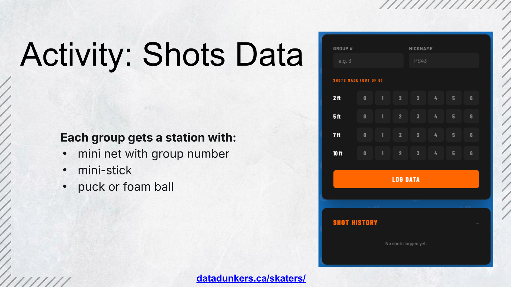

Students enter the group number posted at the net and their player ID. For each distance, they enter the number of successful shots and submit the result before continuing.

## Slide 19: Esports

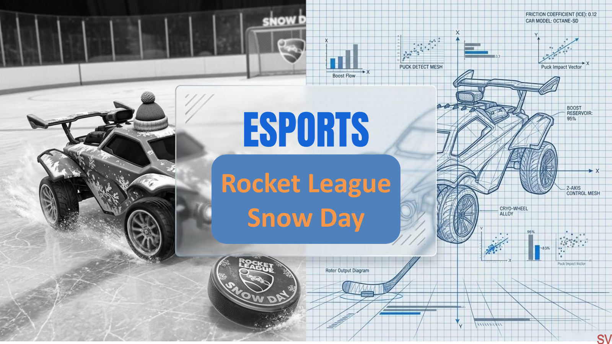

Call students out individually for Rocket League so the rest of the group can continue with other activities. Record each student's result under the same player ID used at every other station.

## Slide 24: Using AI

After collection, use the downloaded data with an approved local or cloud AI tool. Invite students to ask questions such as:

- Which traits appear related to shooting performance?
- How does accuracy change with distance?
- Which groups have the strongest results?

Explain that AI can help find patterns, but students should question and interpret its results.

## Slide 25: Player archetypes

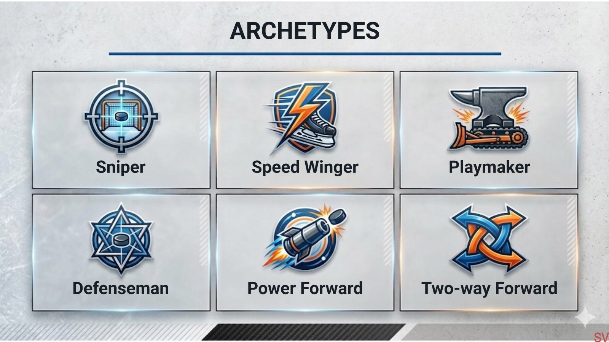

Explain that archetypes describe patterns in the collected results. They are useful for discussion, but they do not describe the whole person. Leadership, effort, communication, friendship, and teamwork are not fully captured by this dataset.

## Slide 27: Closing

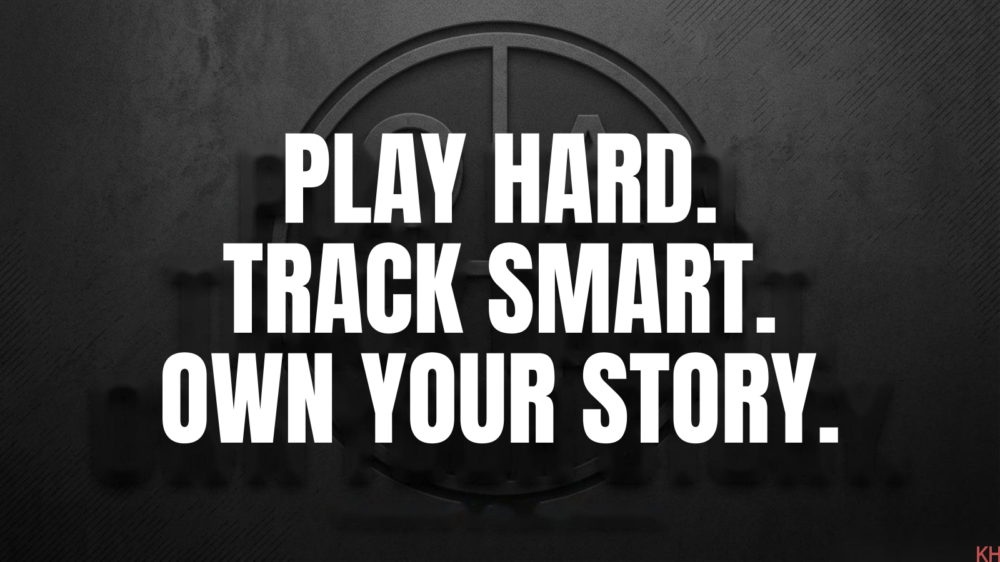

Connect the session back to participation, careful data collection, and ownership of personal information.

## Slide 28: Player cards

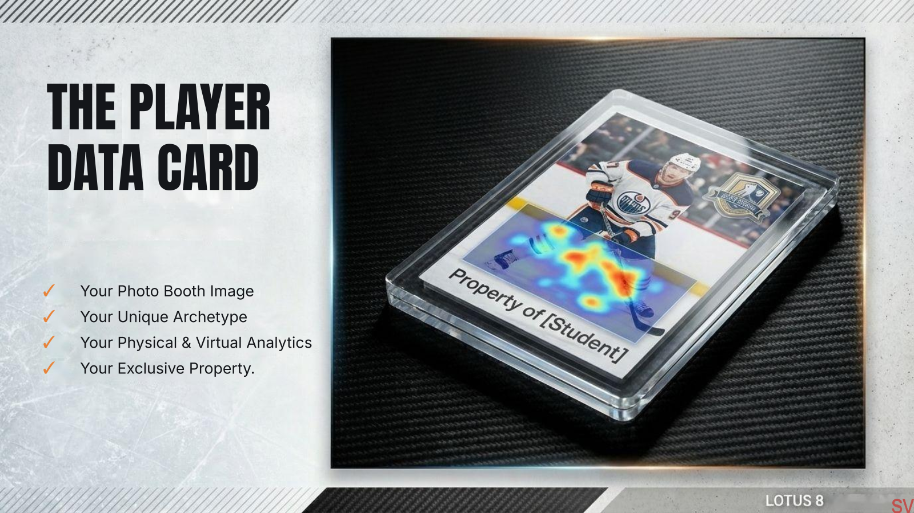

Hand out the cards. Give students time to review their photo, archetype, and results, and to ask how their data contributed to the final card.

## Quick checks

- Use the [Collected Data page](https://datadunkers.ca/skaters/collected) to find missing entries.
- Use the [Nicknames page](https://datadunkers.ca/skaters/nicknames) to check IDs and photos.
- Offer seated, paired, shorter-distance, larger-target, or recorder roles when needed.
- If creating teams with AI, remind students that the data offers a starting point, not a complete judgment of ability.
